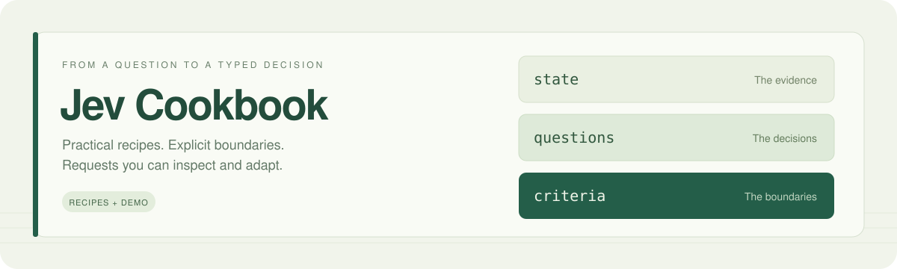

<div align="center">



# Jev Cookbook

**把决策写清楚，把 Jev 请求用起来。**

围绕 `state`、`questions` 与 `criteria`，整理真实项目中的请求设计方法。<br>
从一个可复制的示例开始，逐步理解材料、判断和选项边界。

[](https://github.com/freezetheflame/jev-cookbook/actions/workflows/validate.yml)
[](LICENSE)
[](#来源与验证)

[体验转换器](#先试试转换器) · [查找配方](#按场景查配方) · [请求设计](#理解请求结构) · [查看调研](research/2026-10-11-products.md)

<sub>Practical recipes for typed decisions with TypeSafe Jev. Source-informed examples, request patterns, and a browser-local converter.</sub>

</div>

---

## 这里有什么

| 入口 | 你可以做什么 |
|---|---|
| **[请求转换器](demo/README.md)** | 输入决策与材料，生成 Noul、Choice、Score 或组合请求，查看依据并导出 JSON |
| **[7 个场景配方](#按场景查配方)** | 从上下文筛选、文档拆分、语义检查等场景出发，直接修改完整示例 |
| **[5 组设计方法](#理解请求结构)** | 理解 state 的组织方式、criteria 的边界、原子拆分与不确定性处理 |
| **[12 个源码快照](sources/README.md)** | 追溯产品如何使用 Jev，以及每条方法对应的实现与 commit |

> **验证状态：源码核查 + 离线检查。** 示例材料为合成数据；尚未测量模型判断效果。转换器生成请求草稿，不产生 Jev 答案。

## 先试试转换器

输入“判断工单类别；判断是否需要人工升级；给故障严重程度评分”，再提供材料、类别定义和评分等级，即可生成三个共享 `state` 的独立问题。

| 模式 | 适合表达 | criteria 结构 |
|---|---|---|
| **Noul** | 是否满足一个条件 | `true` / `false` 边界 |
| **Choice** | 从候选类别中选一个 | 候选项映射 |
| **Score** | 判断程度或等级 | 从低到高的有序数组 |
| **组合拆分** | 同一份材料上的多个独立决策 | 每个问题分别设置类型与标准 |

克隆仓库，用 Python 3.10+ 启动本地页面：

```sh
git clone https://github.com/freezetheflame/jev-cookbook.git
cd jev-cookbook
python -m http.server 8075 --bind 127.0.0.1 --directory demo
```

打开 **[localhost:8075](http://127.0.0.1:8075)**，点击“退款判断”“工单分类”“严重程度”或“三个独立决策”试用。也可以直接用浏览器打开 `demo/index.html`。

**无需 API key，无需安装前端依赖。** 材料在浏览器本地处理，支持修改拆分、选项与等级，以及 JSON 复制和下载。自动建议使用词语和分句规则，生成后仍需检查业务含义。

→ [转换器说明、程序接口与 CLI](demo/README.md)

## 按场景查配方

每个配方包含 **完整请求 · 结果处理 · 实现来源 · 验证状态**。

| 想解决的问题 | 阅读配方 | 复制请求 | 借鉴实现 |
|---|---|:---:|---|
| 工具输出太长，筛选需要保留的块 | [上下文筛选](recipes/01-context-filter.md) | [JSON](examples/context-filter.json) | Winnow |
| 判断单个类别或多个标签 | [分类与标签](recipes/02-classification.md) | [JSON](examples/classification.json) | classifier.dev / jev-align |
| 对混合 PDF 包分类与拆分 | [文档边界](recipes/03-document-boundary.md) | [JSON](examples/document-boundary.json) | DocJev |
| 按含义搜索并定位原文 | [证据定位](recipes/04-evidence-localization.md) | [JSON](examples/evidence-localization.json) | JevPDF |
| 用自然语言规则检查代码变更 | [语义规则检查](recipes/05-semantic-lint.md) | [JSON](examples/semantic-lint.json) | softlint |
| 分别选择模型能力与推理深度 | [模型路由](recipes/06-model-routing.md) | [JSON](examples/model-routing.json) | jev-codex-router / Jev Ultrafast |
| 改善判断定义、评估阈值 | [请求改写与评估](recipes/07-request-evaluation.md) | [JSON](examples/rag-screen.json) | jev-align / Tenbin |

## 理解请求结构

把**证据**放入 `state`，把**需要做出的判断**放入 `questions`，把**选项和判定边界**放入 `criteria`。例如，判断客户是否在查询一笔已有退款的进度：

```json
{
  "model": "jev-1.13.0",
  "state": {
    "message": "Please check the status of my existing refund request."
  },
  "questions": {
    "asks_refund_status": {
      "type": "noul",
      "instructions": "Does `message` ask about the status of an existing refund request?",
      "criteria": {
        "true": "Asks for progress or status of a refund already requested.",
        "false": "Requests a new refund, asks about policy, or provides no evidence of a status inquiry."
      }
    }
  }
}
```

官方选项字段为 **`criteria`**。Noul 可定义两侧边界，Choice 使用映射，Score 使用有序数组。详见 [官方 API 文档](https://docs.typesafe.ai/api)。

| 设计问题 | 对应方法 |
|---|---|
| 哪些材料应该放进请求？如何保留关系？ | [State：证据、关系与预算](patterns/state-design.md) |
| 怎样写清楚类别、等级和边界？ | [Criteria：覆盖范围与问题类型](patterns/criteria-design.md) |
| 多个判断如何拆开，再用代码组合？ | [原子问题与代码组合](patterns/atomic-decisions.md) |
| 如何区分概率、confidence 与执行阈值？ | [不确定性与复核](patterns/uncertainty.md) |
| 版本、失败路径和调用成本如何控制？ | [运行时设计](patterns/runtime.md) |

## 运行与验证

脚本使用 Python 标准库。下面两条命令会校验仓库并打印一个请求，均离线运行：

```sh
python scripts/validate.py
python scripts/run_recipe.py examples/document-boundary.json
```

<details>
<summary><strong>调用 Jev API：配置 key 与发送请求</strong></summary>

设置 `TYPESAFE_API_KEY`，并显式添加 `--send`。**此操作会调用收费 API。**

**Windows PowerShell**

```powershell
$env:TYPESAFE_API_KEY = "YOUR_KEY"
python scripts/run_recipe.py examples/document-boundary.json --send --output runs/document-boundary.json
```

**macOS / Linux**

```sh
export TYPESAFE_API_KEY="YOUR_KEY"
python scripts/run_recipe.py examples/document-boundary.json --send --output runs/document-boundary.json
```

示例固定 `jev-1.13.0`，响应记录包含实际模型与耗时。输出文件已存在时需加 `--overwrite`。`runs/`、`.env` 被 Git 忽略；脚本从环境变量取 key，不读取 `.env`。

</details>

<details>
<summary><strong>开发转换器：运行离线测试</strong></summary>

需要 Node.js 20+ 与 Python 3.10+，无需 npm 依赖：

```sh
node --test demo/converter.test.cjs
python demo/check_schema.py
python scripts/validate.py
```

检查转换行为、材料引用、候选边界和生成请求的结构；这些检查不衡量模型准确率。

</details>

## 来源与验证

方法整理自官方文档与作者源码，核查日期 **2026-10-11**。每个配方明确区分以下证据级别：

| 级别 | 含义 | 当前配方 |
|---|---|:---:|
| **源码核查** | 阅读具体实现并记录精确 commit | ✓ |
| **离线检查** | 检查 JSON、类型、显式引用与文档链接 | ✓ |
| **API 实测** | 保存真实服务响应与运行信息 | 待完成 |
| **效果评估** | 提供留出数据、指标与原始结果 | 待完成 |

作者的演示数字不作为本仓库的实测结果。classifier.dev 的匿名合成请求返回 HTTP 403，记录见 [服务探测](research/classifier-dev-smoke.json)。

[产品调研](research/2026-10-11-products.md) · [源码快照索引](sources/README.md) · [精确来源清单](sources/snapshots.json) · [评估流程](evaluation/README.md)

## 一起补充配方

发现一个实用场景，或有更清晰的 state / criteria 写法？按 [配方模板](templates/recipe.md) 添加示例，并阅读 [贡献说明](CONTRIBUTING.md)。请保留原始实现的来源链接，为新方法与阈值标明验证程度。

---

<div align="center">

**从一份清楚的材料，到一个边界明确的判断。**

<sub>独立社区项目 · MIT 许可覆盖本仓库自行编写的文档与示例<br>引用项目、服务和模型保留其各自条款。</sub>

</div>
